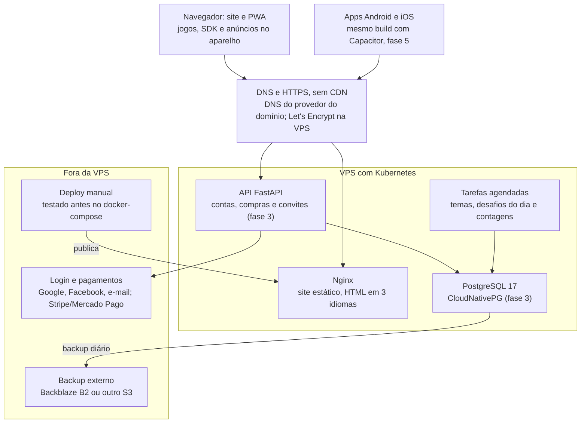

# RFC-001 · Arquitetura técnica do ZupLoop

8 de novembro de 2026 · Juliano Fabio Miranda

## Metadados

Este RFC propõe a arquitetura técnica do ZupLoop.com para as fases 1 a 5 do PRD e está aberto para revisão até 15 de novembro de 2026.

| Campo | Valor |
| --- | --- |
| Identificador | RFC-001 |
| Título | Arquitetura técnica do ZupLoop |
| Autor | Juliano Fabio Miranda |
| Status | Em revisão |
| Data | 8 de novembro de 2026 |
| Revisores | Juliano Fabio Miranda (dono do produto e desenvolvedor) e Claude (assistente de IA), os participantes das sessões de definição de 6 a 8 de novembro de 2026 |
| Base | [PRD do ZupLoop](../prd.md) e [Plano da Plataforma de Jogos](https://claude.ai/artifact/9YBHPgcCpV3hEHqrxYzQw7) |
| Telas | [Telas do ZupLoop](https://claude.ai/artifact/WctBmtoD4uAnnXeZha8Gof) |
| Próximo passo | Aprovado o RFC, os ADRs passam a "Aceito" e começa a especificação 001 Fundação |

## Resumo executivo (TL;DR)

Propomos um site estático em Next.js 16, servido pelo Nginx no Kubernetes da VPS, sem CDN na frente, com uma API própria em FastAPI e PostgreSQL que entra só na fase 3.

- **Jogar nunca depende do servidor.** O site é HTML pronto em 3 idiomas, e o progresso é salvo primeiro no aparelho. Com a API fora do ar, tudo continua funcionando, menos login, compras e partidas com amigos.
- **Cada jogo é um pacote independente** que só fala com o SDK do portal. Adicionar um jogo é criar um pacote e registrá-lo, sem mexer no portal.
- **O mesmo código gera site e apps.** O build estático vira PWA na fase 2 e apps Android e iOS com Capacitor na fase 5.
- **A API cuida só do que precisa de servidor:** contas, sincronização, confirmação de compras e partidas por convite, com as jogadas validadas no servidor.
- **O custo fixo é só a VPS e o domínio.** Os demais serviços usam planos gratuitos ou cobram por venda.

Pedimos aos revisores uma decisão sobre essa arquitetura e sobre as questões em aberto antes do início da especificação 001.

## Contexto e problema

O ZupLoop é um site e app de passatempos clássicos para adultos (caça-palavras, sudoku, 2048 e damas), em português, espanhol e inglês, gratuito com anúncios discretos e compras únicas. O problema técnico é escolher uma arquitetura que atenda o PRD dentro destas restrições:

| Restrição | O que exige da arquitetura |
| --- | --- |
| Uma pessoa, nas horas vagas, com código gerado por IA | Poucas peças, tecnologias bem documentadas e versões consolidadas, testes que pegam erros da IA |
| Custo fixo só de VPS e domínio | Tudo no Kubernetes da VPS; serviços externos só em plano gratuito ou cobrados por venda |
| Crescimento pela busca do Google | HTML pronto por página, em 3 idiomas, com `hreflang`, Core Web Vitals bons e "Como jogar" em texto |
| Muitos jogos adicionados ao longo do tempo | Jogos independentes do portal, com um contrato único e regras testáveis |
| Login só opcional, desde a fase 3 | Progresso salvo no aparelho antes da conta e juntado a ela depois, sem refazer os jogos |
| Site, PWA e apps Android e iOS | Um só código de front-end reaproveitado nas lojas |
| Damas com amigos por link na fase 4 | Partidas guardadas no servidor e jogadas validadas lá |
| Uma única VPS | Site que continua no ar se a API ou o banco caírem; backup fora da VPS |

O desenvolvedor escolheu Next.js com TypeScript no front-end (pelo mercado de trabalho) e Python só nos serviços e no banco, sem gerar páginas em Python.

## Proposta técnica

A solução tem duas metades que não dependem uma da outra para o jogo funcionar: um front-end estático, que é o produto, e uma API, que guarda o que precisa de servidor. O detalhe de cada parte fica no plano técnico das especificações.

Se a API ou o banco caírem, o Nginx continua servindo o site e os jogos salvam no aparelho; só login, compras e convites param.

### Front-end estático

- **Next.js 16 com exportação estática** (`output: 'export'`). Cada idioma, jogo, tema e nível vira um arquivo HTML no build, com título, descrição, `hreflang` e "Como jogar" no próprio HTML.
- **Idiomas com next-intl**, em pastas `/pt/`, `/es/` e `/en/`, com nomes traduzidos (`/pt/caca-palavras/frutas`, `/es/sopa-de-letras/frutas`). Redirecionamento automático só na raiz.
- **O jogo só carrega ao tocar em "Jogar"**, para a página abrir rápido e manter bons Core Web Vitals.
- **PWA com Serwist na fase 2**: o site pode ser instalado e os jogos já abertos funcionam sem internet.
- **Servido por um contêiner Nginx** no Kubernetes, com compressão e cache longo no navegador para os arquivos com hash.

### Jogos como pacotes

- Cada jogo é um pacote em `packages/games/<jogo>` com duas partes: **regras** em TypeScript puro, sem interface e com testes, e **tela** em React.
- Cada jogo declara um manifesto com identificador, nome e endereço por idioma, categoria e fase de lançamento. O portal monta catálogo, páginas e rotas a partir dos manifestos.
- Um jogo novo entra criando o pacote e registrando o manifesto, sem alterar o portal.

### SDK do portal

O SDK é o único contrato entre jogo e portal. Ele oferece:

- `save` e `load`: salvamento local primeiro, com número de versão em cada save, e sincronização com a conta quando houver login;
- `getLocale`: o idioma da página;
- `commercialBreak` e `rewardedBreak`: os intervalos de anúncio, que usam AdSense e a solução de anúncios para jogos HTML5 do Google no site, e AdMob nos apps, sem o jogo saber qual;
- favoritos e eventos de analytics.

### Conteúdo

- Temas são arquivos JSON por idioma em `content/themes/`, revisados e versionados no repositório. Publicar um tema é aprovar o arquivo e rodar o build.
- Na fase 2, uma tarefa agendada (a fábrica de temas) gera rascunhos com IA, confere as palavras num dicionário e aplica filtro de palavras impróprias. Nada é publicado sem aprovação manual.
- Os desafios do dia são agendados com pelo menos 2 semanas de antecedência e também são dados no build.

### API e banco (a partir da fase 3)

- **FastAPI em Python 3.13 com Pydantic 2**, **SQLAlchemy 2.0** e **Alembic** para as migrações, sobre **PostgreSQL 17** gerenciado pelo CloudNativePG dentro do cluster.
- Responsabilidades:
  - login com Google, Facebook, código por e-mail e, nos apps iOS, Apple, com uma conta podendo ter várias formas de entrar (ADR-0010);
  - sincronização de saves e favoritos, com o save mais recente vencendo em conflito do mesmo jogo;
  - compras confirmadas só pelo aviso do meio de pagamento ao servidor;
  - partidas de damas por convite (fase 4), guardadas no servidor, com cada jogada validada lá.
- Cada pessoa só lê e grava os próprios dados, com limite de tentativas no login e na API.

### Apps (fase 5)

- **Capacitor** empacota o mesmo build estático em apps Android e iOS. A versão é escolhida no início da fase 5.
- Os apps acrescentam o que as lojas exigem para não serem só um site embrulhado: notificações, compras das lojas unificadas pelo RevenueCat, AdMob, "Entrar com Apple" e modo offline.

### Operação

- **Testes antes de publicar:** o GitHub Actions roda os testes a cada alteração. A publicação no Kubernetes é manual, feita pelo desenvolvedor só com todos passando.
- **docker-compose para testes:** sobe site, API, banco e tarefas na máquina de desenvolvimento, com as mesmas variáveis de produção.
- **HTTPS** com cert-manager e Let's Encrypt, direto na VPS; DNS no provedor do domínio, sem custo extra.
- **Backup diário** do banco fora da VPS, com restauração testada uma vez por mês.
- **Monitoramento**: registro de erros do site, dos apps e da API, e um monitor de quedas.
- **Segredos só em variáveis de ambiente:** chaves, senhas e tokens ficam num `.env` lido pelo docker-compose, fora do Git; o repositório tem só o `.env.example`, com os nomes e sem valores. No Kubernetes, as mesmas variáveis viram Secrets criados à mão. Nunca no código nem em conversas com a IA.
- **Versões fixadas**: Node.js 24 LTS, TypeScript 5, React 19, Next.js 16 e as do back-end, listadas no `AGENTS.md` para a IA.

### Relação com o PRD

| Parte | Requisitos atendidos |
| --- | --- |
| Front-end estático | RF-NAV, RF-I18N, RF-AJ-03, RF-APP-01, RNF-01, RNF-03 |
| Jogos e SDK | RF-SDK, RF-CP, RF-SD, RF-2048, RF-DM, RF-FAV, RF-ADS |
| Conteúdo | RF-CONT, RF-DIA |
| API e banco | RF-CONTA, RF-PAG, RF-MULTI, RNF-04, RNF-05 |
| Apps | RF-APP-02 a RF-APP-05, RF-PAG-07 |
| Operação | RNF-06, RNF-08 a RNF-11 |

## Alternativas consideradas

Oito alternativas reais foram discutidas nas sessões de definição e descartadas; cada linha diz o trade-off que levou ao descarte e o ADR que registra a decisão.

| Alternativa | Ponto forte | Por que foi descartada | Decisão adotada | ADR |
| --- | --- | --- | --- | --- |
| Astro com TypeScript no front-end | Mais leve e mais fácil de aprender; feito para sites de conteúdo | Chegou a ser escolhido, mas tem bem menos vagas no mercado e menos material para a IA. O desenvolvedor aceitou aprender mais (cerca de 1 semana a mais na fase 1) em troca do mercado de trabalho | Next.js 16 em exportação estática | ADR-0001 |
| HTML, CSS e JavaScript puros, com Python gerando as páginas | Menos ferramentas; um só back-end | O desenvolvedor não quer Python gerando páginas, só serviços e banco. Sem componentes nem rotas por idioma, 3 idiomas e dezenas de jogos virariam código repetido | Front-end em Next.js e Python só na API | ADR-0001, ADR-0002 |
| Next.js como servidor (renderização a cada visita) | Recursos de servidor do Next.js, páginas dinâmicas | Exige um processo Node no ar para o site existir: mais memória na VPS e o site cai junto com o servidor. As páginas do ZupLoop mudam só quando entra conteúdo, então HTML pronto basta | Exportação estática servida pelo Nginx | ADR-0001 |
| Serviço pronto de back-end (Supabase) | Login, banco e API prontos; cerca de 1 semana a menos na fase 3 | Menos controle e menos aprendizado; dependeria dos limites do plano gratuito e de outro fornecedor. A API própria custa mais código de segurança, que será revisado à mão | API própria em FastAPI com PostgreSQL | ADR-0002 |
| Hospedagem gerenciada (Vercel, Netlify ou similar) | Sem servidor para cuidar; publicação simples | O desenvolvedor já paga uma VPS com Kubernetes e quer gastar só com ela e o domínio. O preço aceito é uma VPS como ponto único de falha e backups por conta própria | Tudo na VPS, sem CDN na frente | ADR-0003 |
| Cloudflare gratuita na frente da VPS | Cache perto do jogador, proteção contra tráfego abusivo e DNS, sem custo | Descartada pelo dono do produto em 8 de novembro de 2026. O preço aceito são páginas mais lentas para quem está longe da VPS e proteção só pelo Nginx e pelo firewall | VPS servindo direto, sem CDN | ADR-0003 |
| Adversário aleatório desde o início | Jogar sem ter amigo para convidar | Precisa de muitos jogadores ao mesmo tempo e de partidas ao vivo, o que não existe no lançamento. O convite por link funciona com pouco tráfego e ainda divulga o site | Convite por link na fase 4 | ADR-0006 |
| Usar sempre a versão mais nova das bibliotecas | Recursos mais recentes | A IA pode não conhecer a documentação mais nova e gerar código errado. O Next.js 15 também foi descartado, por sair do suporte em outubro de 2026 | Versões consolidadas e fixadas | ADR-0007 |

Também foi descartado o **login obrigatório**, porque o cadastro faz parte do público desistir antes de jogar; isso está no ADR-0005.

## Questões em aberto

Oito pontos levantados nas sessões ficaram sem decisão ou foram adiados de propósito; nenhum bloqueia a fase 1, e cada um tem a especificação antes da qual precisa ser decidido.

| ID | Questão | Opções em discussão | Decidir antes de |
| --- | --- | --- | --- |
| Q-01 | Meio de pagamento no site | Stripe ou Mercado Pago, com Pix e cartão | 016 Compra Sem anúncios (fase 3) |
| Q-02 | Regras das damas | Damas brasileira (8×8, captura obrigatória, dama que anda várias casas) ou regras diferentes por idioma | 017 Damas (fase 4) |
| Q-03 | Serviço de envio de e-mail | Brevo ou Resend, no plano gratuito | 012 API e login (fase 3) |
| Q-04 | Registro de erros | GlitchTip na própria VPS (consome memória do cluster) ou Sentry no plano gratuito | 005 Anúncios, consentimento e analytics (fase 1) |
| Q-05 | Destino do backup | Backblaze B2 ou outro armazenamento compatível com S3 | 012 API e login (fase 3) |
| Q-06 | Versão do Capacitor | Adiada de propósito: escolher a versão consolidada no início da fase 5 | 019 App Android (fase 5) |
| Q-07 | Conflito de marca do nome ZupLoop | Busca no INPI, USPTO e EUIPO; manter o nome ou trocar antes de investir na marca | Divulgação paga ou registro de marca |
| Q-08 | Quando ligar a seção "Mais jogados" | Os dados são coletados desde a fase 1, mas o volume mínimo de partidas para mostrar a seção não foi definido | Quando houver volume considerado relevante |

Este RFC levanta também um ponto novo para os revisores:

| ID | Questão | Opções | Decidir antes de |
| --- | --- | --- | --- |
| Q-09 | Como o servidor valida as jogadas das damas, se as regras ficam em TypeScript (RF-SDK-04) e a API é em Python (RF-MULTI-05) | Reescrever as regras em Python, com uma bateria de casos de teste comum às duas versões; ou um pequeno serviço em Node só para validar partidas, reaproveitando o pacote de regras | 018 Convite por link (fase 4) |

## Impacto e riscos

A proposta mantém o custo fixo em VPS e domínio e deixa o jogo independente do servidor. Em troca, o desenvolvedor assume a operação da VPS e cerca de 2 semanas a mais no cronograma (aprender Next.js e escrever a API).

**Impacto**

| Área | Impacto |
| --- | --- |
| Produto | Páginas rápidas e indexadas em 3 idiomas; jogos funcionam sem conta e sem internet depois de abertos; login, compras e convites dependem da API |
| Desenvolvimento | Monorepo com `apps/web`, `apps/api`, `packages/sdk` e `packages/games`; um jogo novo não mexe no portal; cronograma de 22 semanas já inclui +1 semana de Next.js e +1 de API |
| Custo | Fixo só VPS e domínio; pagamentos e lojas cobram por venda; demais serviços em plano gratuito |
| Operação | Atualizações da VPS e do cluster, backup e teste de restauração mensal ficam com o desenvolvedor |
| Segurança e privacidade | Dados pessoais só a partir da fase 3, com coleta mínima (e-mail, apelido, progresso); compras confirmadas só pelo servidor |

**Riscos técnicos**

| Risco | Probabilidade | Impacto | Mitigação |
| --- | --- | --- | --- |
| Código gerado por IA com falhas de segurança no login, nos dados ou nos pagamentos | Média | Alto | Revisão manual desses trechos, testes da API com acesso só aos próprios dados, publicação só com testes passando |
| VPS fora do ar ou perda do banco | Baixa | Alto | Salvamento local, site republicável em outra máquina com as mesmas imagens, backup diário fora da VPS, restauração testada, monitor de quedas |
| Google ou Facebook mudam regras, recusam o app ou o login deles sai do ar | Baixa | Médio | Código por e-mail sempre disponível; várias formas de entrar ligadas à mesma conta; política de privacidade e exclusão de dados prontas antes de pedir aprovação |
| Arquivo .env com segredos enviado ao Git, copiado para a IA ou perdido | Média | Alto | .env no .gitignore; verificação de segredos no código a cada alteração (por exemplo, gitleaks); cópia dos valores de produção num gerenciador de senhas; trocar a chave na hora se vazar |
| Sem CDN, páginas lentas para jogadores longe da VPS, como os de língua espanhola e inglesa | Média | Médio | Compressão, cache longo no navegador, páginas leves e jogo carregado só ao tocar em "Jogar"; medir Core Web Vitals por país e reabrir a decisão no ADR-0003 se ficarem ruins |
| Tráfego abusivo ou ataque derruba a VPS | Baixa | Alto | Limite de requisições no Nginx e na API, firewall da VPS só com as portas necessárias, monitor de quedas |
| A prévia do link de convite precisa de título e imagem por partida, o que um site estático não gera | Alta | Médio | A API serve uma página mínima com as tags de prévia em `/c/<id>`, que leva à tela estática do convite |
| Exportação estática não tem middleware do Next.js para redirecionar pelo idioma | Alta | Baixo | Redirecionamento só na raiz, feito pelo Nginx ou por um script mínimo; as outras páginas não redirecionam (RF-I18N-02) |
| Tempo de build cresce com milhares de páginas de tema em 3 idiomas | Média | Médio | Medir o build a cada fase; cache do build no GitHub Actions; separar o build de conteúdo se passar do limite aceitável |
| Regras das damas em duas linguagens divergem (Q-09) | Média | Médio | Bateria de casos de teste única rodando no TypeScript e no Python, ou serviço de validação em Node |
| Conflito de sincronização apaga progresso | Baixa | Médio | Versão e data em cada save; o mais recente vence só dentro do mesmo jogo; testes do fluxo de juntar dados ao entrar |
| Memória da VPS insuficiente para Nginx, API, Postgres, tarefas e monitoramento | Média | Médio | Limites de recursos por serviço no Kubernetes; preferir serviços externos gratuitos para erros (Q-04) |
| Loja da Apple recusa o app por ser só um site | Média | Médio | Recursos nativos na fase 5: notificações, compras da loja, "Entrar com Apple" e modo offline |
| Versões fixadas saem do suporte | Baixa | Médio | Revisão anual das versões, registrada num novo ADR |

Os riscos de negócio (tráfego do Google, marca, anúncios) estão no PRD.

## Decisões relacionadas

Este RFC gera dez ADRs, todos com status "Proposto" até a aprovação; eles ficam em `docs/decisions/`.

| ADR | Decisão | Seção do RFC |
| --- | --- | --- |
| [ADR-0001](../decisions/0001-nextjs-exportacao-estatica.md) | Next.js 16 em exportação estática | Front-end estático |
| [ADR-0002](../decisions/0002-api-fastapi-postgres.md) | API própria em FastAPI com PostgreSQL | API e banco |
| [ADR-0003](../decisions/0003-tudo-na-vps.md) | Tudo na VPS com Kubernetes, sem CDN na frente | Operação |
| [ADR-0004](../decisions/0004-jogos-e-sdk.md) | Jogos como pacotes atrás do SDK do portal | Jogos como pacotes; SDK do portal |
| [ADR-0005](../decisions/0005-local-primeiro-login-opcional.md) | Salvamento local primeiro e login opcional | SDK do portal; API e banco |
| [ADR-0006](../decisions/0006-convite-por-link.md) | Multijogador por convite, com jogadas validadas no servidor | API e banco |
| [ADR-0007](../decisions/0007-versoes-fixadas.md) | Versões consolidadas e fixadas | Operação |
| [ADR-0008](../decisions/0008-apps-capacitor.md) | Apps com Capacitor sobre o build estático | Apps |
| [ADR-0009](../decisions/0009-env-compose-deploy-manual.md) | Segredos em .env, docker-compose para testes e deploy manual no Kubernetes | Operação |
| [ADR-0010](../decisions/0010-autenticacao.md) | Login com Google, Facebook e código por e-mail; Apple só no iOS | API e banco |

As questões em aberto Q-01 a Q-09 viram ADRs novos quando forem decididas.
