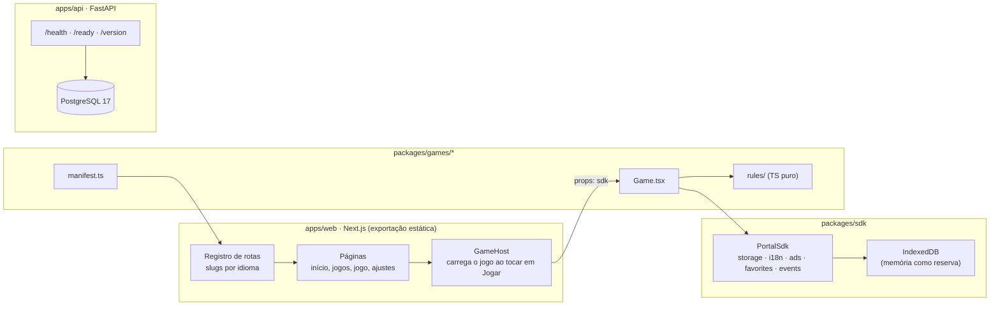
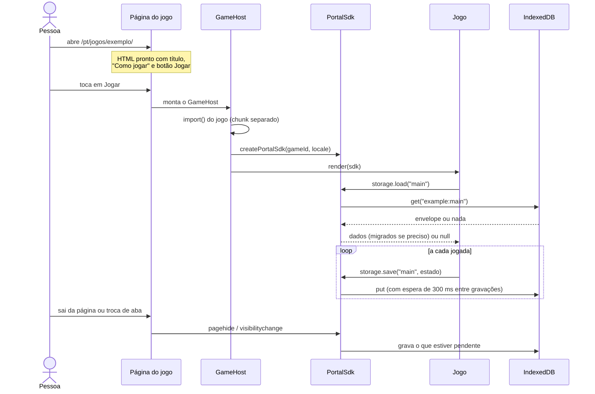

# FDD 001 · Fundação

| Campo | Valor |
| --- | --- |
| Feature | 001 Fundação |
| Fase | 1 · Primeira versão |
| Status | Proposto, aguardando revisão |
| Data | 8 de novembro de 2026 |
| Autor | Juliano Fabio Miranda |
| Base | [PRD](../../prd.md) · [RFC-001](../../rfcs/0001-arquitetura-tecnica.md) |
| ADRs desta feature | [0011](../../decisions/0011-monorepo-pnpm-uv.md) · [0012](../../decisions/0012-qualidade-e-testes.md) · [0013](../../decisions/0013-rotas-traduzidas-sem-middleware.md) · [0014](../../decisions/0014-contrato-do-sdk-e-salvamento.md) · [0015](../../decisions/0015-docker-compose-e-configuracao.md) · [0016](../../decisions/0016-formato-de-erros-da-api.md) · [0017](../../decisions/0017-estilos-css-modules.md) · [0018](../../decisions/0018-biblioteca-de-interface.md) |
| Padrão de interface | [design-system.md](../../design-system.md) |
| Spec e tarefas | [spec.md](spec.md) · [tasks.md](tasks.md) |
| Telas | [Protótipo](../../prototipo/README.md): Início, Jogos, Ajustes, Site · Início, Site · Jogos |
| ADRs herdados | 0001 a 0010 (RFC-001) |

Este documento diz **como construir** a Fundação. O que ela precisa cumprir vem do PRD; as decisões que valem para o projeto inteiro estão nos ADRs.

## 1. Objetivo

Ao fim da 001 existe um ZupLoop "vazio, mas de pé":

- o site abre em `/pt/`, `/es/` e `/en/`, com navegação, catálogo e página de jogo montados a partir dos manifestos dos jogos;
- a raiz `/` leva cada pessoa ao idioma certo;
- o SDK do portal existe com o contrato completo; salvar e carregar já funcionam no aparelho, e anúncios, favoritos e analytics têm implementações provisórias;
- um jogo de exemplo, invisível em produção, prova o caminho inteiro: tocar em "Jogar", carregar o jogo, salvar, fechar, voltar e continuar;
- a API tem um esqueleto com `/health`, `/ready` e `/version`, ligado ao PostgreSQL, sem nenhuma rota de negócio;
- `docker compose up` sobe site, API e banco com os valores do `.env`;
- o GitHub Actions roda verificações e testes a cada push;
- existe o roteiro para você publicar no Kubernetes.

A partir daqui, cada feature nova só acrescenta: um jogo, uma página, uma rota da API.

## 2. Escopo

### Incluso

| Item | Requisitos do PRD |
| --- | --- |
| Monorepo, ferramentas, `AGENTS.md`, `CLAUDE.md`, CI | RNF-09, RNF-10 |
| Rotas por idioma com nomes traduzidos, raiz com escolha de idioma, seletor e faixa de sugestão | RF-I18N-01 a RF-I18N-05 |
| Textos de interface em arquivos por idioma | RF-I18N-05 |
| Layout: barra inferior no celular, cabeçalho no computador, jogo em tela cheia | RF-NAV-04 |
| Página inicial e catálogo a partir dos manifestos; catálogo com busca e filtros por categoria | RF-NAV-01 (parcial), RF-NAV-02 |
| Página de jogo genérica com "Como jogar" e "Jogar" | RF-NAV-03, RF-AJ-03 (estrutura) |
| SDK do portal: contrato completo; salvar, carregar, idioma e eventos | RF-SDK-01 a RF-SDK-03, RF-I18N-06 |
| Estrutura de pacote de jogo com regras separadas e testadas | RF-SDK-04 |
| SEO base: título, descrição, `canonical`, `hreflang`, mapas do site por idioma, `robots.txt` | RNF-03 |
| Acessibilidade base e orçamento de desempenho | RNF-01, RNF-02, RNF-07 |
| Esqueleto da API e do banco | Preparação para RF-CONTA (fase 3) |
| docker-compose, `.env`, imagens Docker, roteiro de publicação | RNF-04, RNF-06, RNF-11 |

### Fora desta feature

- Qualquer jogo real (o caça-palavras é a 002).
- Anúncios de verdade, banner de consentimento e Google Analytics (005). O SDK já tem as funções, mas elas não mostram nada.
- Favoritos funcionando (008), ajustes além do idioma (009), PWA (010).
- Login, contas e qualquer rota de negócio na API (012 em diante).
- Manifestos do Kubernetes: a publicação é sua (ADR-0009). Este FDD só entrega imagens e o roteiro.

## 3. Visão geral



O site não chama a API nesta feature. A API existe para provar o caminho docker-compose → imagem → Kubernetes antes de ser necessária.

## 4. Estrutura do repositório

```
zuploop/
├── AGENTS.md                     ← regras para a IA (fonte única)
├── CLAUDE.md                     ← importa o AGENTS.md
├── README.md
├── .env.example                  ← nomes das variáveis, valores falsos
├── .gitignore                    ← inclui .env
├── .nvmrc                        ← 24
├── package.json                  ← scripts da raiz, "packageManager": "pnpm@10.x.y"
├── pnpm-workspace.yaml
├── pnpm-lock.yaml
├── docker-compose.yml
├── .github/workflows/ci.yml
├── apps/
│   ├── web/
│   │   ├── next.config.ts
│   │   ├── Dockerfile
│   │   ├── nginx/
│   │   │   ├── default.conf.template
│   │   │   └── config.json.template
│   │   ├── messages/{pt,es,en}.json
│   │   ├── public/
│   │   │   ├── lang.js           ← escolha de idioma na raiz
│   │   │   └── robots.txt
│   │   ├── e2e/                  ← testes Playwright
│   │   └── src/
│   │       ├── app/
│   │       │   ├── (root)/layout.tsx · page.tsx      ← "/" escolha de idioma
│   │       │   └── [locale]/
│   │       │       ├── layout.tsx
│   │       │       ├── page.tsx                      ← início
│   │       │       └── [...slug]/page.tsx            ← demais páginas pelo registro
│   │       ├── i18n/{config.ts,request.ts}
│   │       ├── routes/registry.ts                    ← páginas e slugs por idioma
│   │       ├── games/registry.ts                     ← lista de manifestos
│   │       ├── components/                           ← layout, GameHost, LanguageSwitcher…
│   │       ├── seo/{metadata.ts,sitemap.ts}                  ← metadados e mapas do site
│   │       └── styles/              ← só estilos de montagem; tokens vêm de @zuploop/ui
│   └── api/
│       ├── pyproject.toml · uv.lock · .python-version (3.13)
│       ├── Dockerfile
│       ├── alembic.ini · migrations/
│       ├── app/
│       │   ├── main.py · settings.py · db.py · errors.py · logging.py
│       │   └── routes/health.py
│       └── tests/
├── packages/
│   ├── sdk/src/{index.ts,types.ts,storage/,i18n.ts,ads.ts,favorites.ts,events.ts}
│   ├── ui/src/{tokens.css,base.css,components/,icons/}   ← padrão de interface (ADR-0018)
│   ├── games/example/            ← jogo de exemplo, oculto em produção
│   │   └── src/{manifest.ts,load.ts,load.server.ts,rules/,Game.tsx,messages/}
│   └── config/                   ← tsconfig, eslint e prettier compartilhados
├── content/themes/{pt,es,en}/    ← vazio por enquanto (usado na 002/003)
└── docs/                         ← PRD, RFC, ADRs, specs, runbooks
```

## 5. Fluxos

### F1 · Primeira visita pela raiz `/`

1. O Nginx entrega `/index.html`, uma página leve com o logotipo e três links: Português, Español, English. Ela tem `hreflang="x-default"`.
2. O script `/lang.js` roda antes da pintura e decide o idioma:
   1. escolha salva em `localStorage["zuploop.locale"]`, se for `pt`, `es` ou `en`;
   2. senão, o primeiro item de `navigator.languages` cujo começo seja `pt`, `es` ou `en`;
   3. senão, `en`.
3. O script faz `location.replace("/<idioma>/")`, sem entrar no histórico.
4. Sem JavaScript, ou se o script falhar, a pessoa vê os três links e escolhe. Robôs de busca também veem os links.

Só a raiz redireciona (RF-I18N-02). Nenhuma outra página muda de endereço sozinha.

### F2 · Navegação e troca de idioma

1. Toda página é gerada a partir do **registro de rotas**, que conhece o identificador da página e o caminho em cada idioma (por exemplo, `catalog` = `/pt/jogos/`, `/es/juegos/`, `/en/games/`).
2. O seletor de idioma leva à **mesma página** no outro idioma, usando o registro. Se a página não existe naquele idioma, leva ao catálogo do idioma (RF-I18N-03).
3. Ao trocar, a escolha é salva em `localStorage["zuploop.locale"]` e vence o idioma do navegador dali em diante.

### F3 · Faixa "Ver em português?"

1. Ao abrir qualquer página, um componente de cliente compara o idioma da página com a escolha salva ou, sem escolha, com o idioma do navegador.
2. Se forem diferentes e existir a mesma página no outro idioma, aparece uma faixa discreta no topo: "Ver em português?" com os botões "Ver em português" e "Continuar em español", cada texto no seu idioma.
3. "Continuar" salva o idioma atual como escolha e a faixa some nas próximas visitas.
4. A faixa nunca redireciona sozinha (RF-I18N-04) e não desloca o conteúdo: o espaço é reservado com altura fixa, para não piorar o CLS.

### F4 · Abrir um jogo, jogar e continuar



- O jogo não carrega até "Jogar" (RNF-01). A página de jogo é HTML com o conteúdo de busca.
- Ao tocar em "Jogar", o jogo abre em tela cheia sobre a página, sem a barra inferior, com botão "Voltar" (RF-NAV-04). Voltar fecha o jogo e mantém a pessoa na página.
- O endereço da página não muda ao abrir o jogo. O botão voltar do navegador fecha o jogo: o GameHost empurra um estado no histórico ao abrir e fecha o jogo no `popstate`.

### F5 · Save de versão antiga

1. Cada jogo declara `saveVersion` no manifesto e uma função `migrateSave(fromVersion, data)`.
2. Ao carregar, se `envelope.v < saveVersion`, o SDK chama `migrateSave` e grava o resultado com a versão nova.
3. Se a migração lançar erro, ou se `envelope.v > saveVersion` (save de uma versão mais nova do jogo), o SDK descarta o save, registra o evento `save_discarded` e devolve `null`.
4. O jogo começa uma partida nova e mostra o aviso traduzido "Não foi possível recuperar sua partida anterior." (RF-SDK-03).

### F6 · Testar localmente e publicar

1. `cp .env.example .env` e preencher os valores.
2. `docker compose up --build` sobe `db`, `api` (que roda as migrações ao iniciar) e `web`.
3. Site em `http://localhost:8080`, API em `http://localhost:8000`.
4. Para publicar, seguir `docs/runbooks/publicar.md`: gerar as imagens com a versão, enviar ao registro, atualizar Secrets e aplicar no cluster. Você faz isso à mão (ADR-0009).

## 6. Contratos

### 6.1 Manifesto de jogo

```ts
// packages/sdk/src/types.ts
export type Locale = "pt" | "es" | "en";

export type GameCategory = "words" | "board" | "numbers" | "logic"; // rótulo vem dos arquivos de idioma

export interface GameManifest {
  id: string;                          // "word-search"; em inglês, estável, nunca muda
  category: GameCategory;
  phase: 1 | 2 | 3 | 4 | 5;            // fase de lançamento
  status: "available" | "coming_soon" | "hidden"; // hidden: só em dev e testes
  slugs: Record<Locale, string>;       // { pt: "caca-palavras", es: "sopa-de-letras", en: "word-search" }
  saveVersion: number;                 // começa em 1
  migrateSave?: (fromVersion: number, data: unknown) => unknown;
  messages: Record<Locale, () => Promise<GameMessages>>;
  load: () => Promise<{ default: React.ComponentType<GameProps> }>; // via "#load" (ver abaixo)
}

export interface GameMessages {
  name: string;                        // nome exibido
  description: string;                 // meta description e card
  howToPlay: { rules: string[]; controls: string[]; tip: string };
  ui: Record<string, string>;          // textos internos do jogo
}

export interface GameProps {
  sdk: PortalSdk;
  onExit: () => void;
}
```

Regras:

- `id` e `slugs` são únicos entre todos os jogos; um teste do registro garante isso.
- O `load` de cada jogo vem de `import { loadGame } from "#load"`, com *subpath imports* no `package.json` do jogo: a condição `react-server` aponta para `load.server.ts` (não importa a tela) e a padrão para `load.ts` (`() => import("./Game")`). Sem isso, o servidor veria o `import("./Game")` e o Next mandaria o chunk do jogo em toda página, antes de "Jogar" (RNF-01). Decisão registrada em `notas.md` (N-46).
- Jogos `hidden` não entram no catálogo, no mapa do site nem nas páginas geradas quando `ZUPLOOP_SHOW_HIDDEN_GAMES` não é `true` no build.
- Jogos `coming_soon` aparecem no catálogo com o selo "Em breve" e sem página própria.

### 6.2 SDK do portal

```ts
// packages/sdk/src/types.ts
export const SDK_VERSION = 1;

export interface PortalSdk {
  readonly version: typeof SDK_VERSION;
  readonly gameId: string;

  getLocale(): Locale;

  i18n: {
    t(key: string, params?: Record<string, string | number>): string;
  };

  storage: {
    load<T>(slot?: string): Promise<T | null>;   // slot padrão: "main"
    save<T>(slot: string, data: T): Promise<void>;
    clear(slot?: string): Promise<void>;
    readonly persistent: boolean;                // false = só em memória (navegação privada)
  };

  ads: {
    commercialBreak(): Promise<AdResult>;        // intervalo no fim da partida
    rewardedBreak(): Promise<AdResult>;          // dica com recompensa
  };

  favorites: {
    isFavorite(ref: FavoriteRef): Promise<boolean>;
    toggle(ref: FavoriteRef): Promise<boolean>;  // devolve o novo estado
  };

  events: {
    track(name: GameEventName, props?: Record<string, string | number | boolean>): void;
  };
}

export type AdResult = { shown: boolean; rewarded: boolean };

export interface FavoriteRef {
  kind: "game" | "theme" | "level";
  gameId: string;
  id?: string;
}

export type GameEventName =
  | "game_start" | "game_end" | "game_abandon"
  | "hint_used" | "tutorial_skip" | "tutorial_done"
  | "result_shared" | "favorite_set" | "save_discarded";
```

Comportamento nesta feature:

| Parte | Implementação na 001 | Implementação definitiva |
| --- | --- | --- |
| `getLocale`, `i18n.t` | Completa | 001 |
| `storage` | Completa: IndexedDB, memória como reserva | 001; sincronização com a conta na 013 |
| `ads` | Provisória: resolve `{ shown: false, rewarded: true }` na hora, para o jogo seguir e a dica funcionar | 005 |
| `favorites` | Provisória: guarda em memória | 008 |
| `events` | Provisória: em desenvolvimento escreve no console; em produção não envia nada | 005 |

Regras do contrato:

- Toda função assíncrona **nunca rejeita** por falha de infraestrutura (armazenamento cheio, IndexedDB bloqueado, anúncio indisponível). Ela resolve com um valor neutro e registra o erro. O jogo nunca quebra por causa do portal.
- `i18n.t` com chave inexistente devolve o texto em inglês. Se a chave também não existir em inglês, devolve a própria chave e avisa no console em desenvolvimento (RF-I18N-05).
- O SDK é criado por jogo aberto e descartado ao fechar. Ele não guarda estado global além do armazenamento.
- Mudanças no contrato que quebrem jogos exigem `SDK_VERSION` novo e um ADR.

### 6.3 Envelope do save

```ts
interface SaveEnvelope<T = unknown> {
  v: number;           // saveVersion do jogo quando foi gravado
  sdk: 1;              // versão do formato do envelope
  gameId: string;
  slot: string;
  updatedAt: string;   // ISO 8601, UTC
  data: T;
}
```

- Banco IndexedDB `zuploop`, versão 1, object store `saves`, chave `"<gameId>:<slot>"`.
- O `updatedAt` vai ser usado na 013 para resolver conflitos ("o mais recente vence").
- Tamanho máximo de `data` serializado: 256 KB. Acima disso, o SDK recusa a gravação e registra o erro (`save_too_large`); o jogo continua.

### 6.4 Registro de rotas

```ts
// apps/web/src/routes/registry.ts
export type PageId = "home" | "catalog" | "game" | "settings" | "not-found";

export interface RouteDef {
  id: PageId;
  slugs: Record<Locale, string[]>;     // [] = início do idioma
}

// Exemplos
// home      → /pt/          /es/           /en/
// catalog   → /pt/jogos/    /es/juegos/    /en/games/
// game      → /pt/jogos/<slug do jogo>/ (a partir dos manifestos)
// settings  → /pt/ajustes/  /es/ajustes/   /en/settings/
// not-found → /pt/404/      /es/404/       /en/404/
```

- `[...slug]/page.tsx` usa `generateStaticParams` para gerar todos os caminhos do registro, em todos os idiomas, e decide qual página mostrar pelo `PageId`.
- `getAlternates(pageId, params)` devolve o endereço da mesma página em cada idioma. Ele alimenta o seletor de idioma, a faixa de sugestão, as tags `hreflang` e o mapa do site.
- Links internos usam um componente `<LocalizedLink page="catalog" />`, nunca caminhos escritos à mão.

### 6.5 Mensagens de interface

- Arquivos `apps/web/messages/{pt,es,en}.json`, carregados pelo next-intl.
- Chaves em inglês, agrupadas por área: `nav.home`, `nav.games`, `catalog.title`, `game.play`, `game.howToPlay`, `lang.suggest`.
- O inglês é a referência: toda chave existe em `en.json`. Um teste falha se `pt.json` ou `es.json` tiverem chaves que não existem em `en.json`, e lista as chaves que faltam neles.
- Os textos de cada jogo ficam no pacote do jogo (`GameMessages`), não nesses arquivos.

### 6.6 Configuração pública em tempo de execução

O site é o mesmo arquivo em teste e em produção. O que muda por ambiente, e não é segredo, vem de `/config.json`, gerado pelo contêiner do Nginx ao iniciar, a partir das variáveis de ambiente:

```json
{
  "environment": "local",
  "apiBaseUrl": "http://localhost:8000",
  "analyticsEnabled": false,
  "version": "2026.11.08-abc1234"
}
```

- Lido uma vez pelo SDK, com cache `no-store`. Na 001 o arquivo é gerado e servido, mas nada o lê ainda: a leitura entra na 005, a primeira spec com algo a configurar (analytics), e a 012 a usa para a API (decisão de 9/11/2026, S-05).
- Se não carregar, o site usa valores seguros: sem analytics, sem API.
- Nunca contém segredos: tudo que está nele é visível para qualquer visitante.
- A URL pública do site (`SITE_URL`) é a única configuração do site definida no build, porque entra no HTML (`canonical`, `hreflang`, mapa do site). Ela vale sempre `https://zuploop.com`, inclusive no teste local.

### 6.7 API

Todas as respostas são JSON. Erros seguem o formato Problem Details (ADR-0016).

| Método e rota | Uso | Resposta de sucesso | Falha |
| --- | --- | --- | --- |
| `GET /health` | Liveness: o processo está de pé | `200 {"status":"ok"}` | Sem resposta (o Kubernetes reinicia) |
| `GET /ready` | Readiness: o banco responde a `SELECT 1` em até 2 s | `200 {"status":"ready"}` | `503` com `code: "database_unavailable"` |
| `GET /version` | Versão publicada | `200 {"version":"2026.11.08-abc1234","commit":"abc1234"}` | — |

Formato de erro:

```json
{
  "type": "https://zuploop.com/errors/database_unavailable",
  "title": "Database unavailable",
  "status": 503,
  "detail": "The database did not answer in time.",
  "code": "database_unavailable",
  "instance": "/ready",
  "requestId": "01JC…"
}
```

- `code` é estável e é o que o cliente lê. `title` e `detail` são para pessoas e logs, em inglês.
- Todo pedido recebe um `X-Request-ID` (o recebido, se vier, ou um novo), devolvido na resposta e escrito em todos os logs daquele pedido.
- Erros inesperados viram `500` com `code: "internal_error"`, sem detalhes internos na resposta. O detalhe vai só para o log.
- CORS: só as origens de `API_CORS_ORIGINS`.

### 6.8 Variáveis de ambiente (`.env.example`)

| Variável | Usada por | Exemplo | Segredo |
| --- | --- | --- | --- |
| `POSTGRES_USER` | db, api | `zuploop` | Não |
| `POSTGRES_PASSWORD` | db, api | `troque-esta-senha` | **Sim** |
| `POSTGRES_DB` | db, api | `zuploop` | Não |
| `API_ENV` | api | `local` | Não |
| `API_LOG_LEVEL` | api | `info` | Não |
| `API_CORS_ORIGINS` | api | `http://localhost:8080` | Não |
| `PUBLIC_ENVIRONMENT` | web (`/config.json`) | `local` | Não |
| `PUBLIC_API_BASE_URL` | web (`/config.json`) | `http://localhost:8000` | Não |
| `PUBLIC_ANALYTICS_ENABLED` | web (`/config.json`) | `false` | Não |
| `APP_VERSION` | api, web (build) | `local` | Não |
| `ZUPLOOP_SHOW_HIDDEN_GAMES` | web (argumento do build) | `false` | Não |

- A API monta a URL do banco a partir de `POSTGRES_*` e de `DB_HOST` e `DB_PORT` (no compose, `db` e `5432`), para a senha existir num só lugar.
- A API valida as variáveis ao iniciar (pydantic-settings). Faltou uma obrigatória: o processo para com uma mensagem que diz qual. Ela nunca imprime o valor de um segredo.
- Cada feature que precisar de variável nova acrescenta a linha no `.env.example` e nesta tabela, no FDD dela.

## 7. Erros e casos-limite

| Situação | Comportamento | O que a pessoa vê |
| --- | --- | --- |
| JavaScript desligado na raiz | Fica na página de escolha | Três links de idioma |
| `navigator.languages` vazio ou estranho | Usa inglês | Site em inglês |
| `localStorage` bloqueado | Escolha de idioma não é salva; tudo segue funcionando | Nada de diferente |
| IndexedDB indisponível (algumas navegações privadas) | `storage.persistent = false`; saves ficam na memória até fechar a aba | Aviso discreto e único: "Seu progresso não será salvo neste modo do navegador." |
| Armazenamento cheio (`QuotaExceededError`) | Mantém o último save em memória; registra `storage_quota` | Nada; o jogo segue |
| Save maior que 256 KB | Recusa a gravação; registra `save_too_large` | Nada; o jogo segue |
| Save de versão antiga | Migra (F5) | Nada |
| Save que não migra ou de versão mais nova | Descarta e registra `save_discarded` | "Não foi possível recuperar sua partida anterior." |
| Falha ao baixar o chunk do jogo (rede) | Mostra erro com "Tentar de novo"; registra `game_load_failed` | "Não foi possível abrir o jogo. Verifique a conexão e tente de novo." |
| Erro dentro do jogo (exceção no React) | Error boundary do GameHost captura, registra e oferece voltar | "Algo deu errado neste jogo." com "Voltar" e "Tentar de novo" |
| Endereço que não existe | Página 404 do idioma, pelo caminho | "Página não encontrada", com links para início e jogos |
| `/config.json` não carrega | Valores seguros (sem API, sem analytics) | Nada |
| Variável obrigatória faltando na API | Processo não inicia; log diz qual variável | — |
| Banco fora do ar | `/ready` responde `503`; `/health` continua `200` | — (o site não depende da API nesta fase) |
| Chave de tradução faltando | Usa inglês; em dev avisa no console; teste de chaves falha no CI | Texto em inglês |

## 8. Integração com o código

### 8.1 Web

- **Next.js** com `output: "export"`, `trailingSlash: true` e `images: { unoptimized: true }`. A saída fica em `apps/web/out`.
- **Dois layouts raiz** com grupos de rota: `(root)` para a página `/` (com `<html lang="en">`) e `[locale]` para o resto (com `<html lang={locale}>`).
- **next-intl 4** sem middleware: `generateStaticParams` no layout de `[locale]` devolve os três idiomas, e cada layout e página chama `setRequestLocale(locale)` para gerar HTML estático.
- **Metadados** por página com `generateMetadata`: título, descrição, `alternates.canonical` e `alternates.languages`, a partir do registro de rotas e de `SITE_URL`.
- **Mapas do site**: `sitemap.xml` como índice e um arquivo por idioma, com os alternates de cada URL; gerados no build. Jogos `hidden` ficam fora.
- **GameHost** (`"use client"`): recebe o `gameId`, faz o `import()` do jogo e das mensagens, cria o SDK, aplica o error boundary, controla a tela cheia, o histórico e o foco (move o foco para o jogo ao abrir e devolve para o botão "Jogar" ao fechar).
- **Fontes**: Atkinson Hyperlegible (texto) e Lexend (títulos) pelo `next/font`, que baixa os arquivos no build e serve pelo próprio site. Nenhuma chamada a Google Fonts em produção.
- **Estilos**: CSS Modules e os tokens de `@zuploop/ui` (ADR-0017 e ADR-0018), seguindo o [padrão de interface](../../design-system.md). `tokens.css` e `base.css` são importados uma vez no layout raiz. Tamanhos em `rem`, para o ajuste de tamanho de texto da 009 funcionar sem refazer telas.

### 8.2 Pacotes

- `packages/sdk`: TypeScript puro, sem dependência do Next.js. Exporta `createPortalSdk`, os tipos e os adaptadores. O único pacote externo é `idb-keyval` (pequeno, para o IndexedDB).
- `packages/ui`: tokens, `base.css`, componentes e ícones do padrão de interface. Na 001 entram os básicos: `Button`, `IconButton`, `Link`, `Badge`, `GameCard`, `Banner`, `Toast`, `Sheet`, a barra inferior, o cabeçalho e a barra do jogo.
- `packages/games/<jogo>`: `manifest.ts`, `rules/` (sem React, sem DOM), `Game.tsx`, `messages/{pt,es,en}.ts`. Depende só de `react`, `@zuploop/sdk` e `@zuploop/ui`.
- `apps/web/src/games/registry.ts`: a única lista de jogos. Um jogo novo entra com uma linha aqui.
- Regras verificadas pelo ESLint (`no-restricted-imports`): nada em `packages/games` importa de `apps/web`, de `next` ou de outro jogo; nada em `packages/ui` importa do site, dos jogos, do SDK ou do `next`.
- `pnpm lint:styles` falha se houver cor, `font-family` ou tamanho de fonte em `px` fora de `packages/ui/src/tokens.css`.

### 8.3 API

- **FastAPI** com `app/main.py` montando os routers, o middleware de `X-Request-ID`, o CORS e os handlers de erro.
- **Configuração** em `app/settings.py` com pydantic-settings.
- **Banco** em `app/db.py`: SQLAlchemy 2.0 assíncrono com `asyncpg`, um engine por processo, sessão por pedido.
- **Migrações** Alembic em `migrations/`, com uma revisão inicial vazia, só para criar a tabela de controle. O contêiner roda `alembic upgrade head` antes de iniciar o servidor.
- **Logs** em JSON na saída padrão: nível, mensagem, `requestId`, rota, status e duração. Sem e-mail, token ou senha em log.
- **Servidor**: Uvicorn com 1 worker por contêiner; para escalar, aumentam-se réplicas no Kubernetes.

### 8.4 Docker e docker-compose

| Serviço | Imagem | Porta local | Verificação de saúde |
| --- | --- | --- | --- |
| `web` | Build de `apps/web/Dockerfile`: estágio Node 24 gera `out/`, estágio final `nginxinc/nginx-unprivileged` (estável vigente) | `8080` | `GET /healthz` |
| `api` | Build de `apps/api/Dockerfile`: `python:3.13-slim` com uv, usuário sem privilégios | `8000` | `GET /health` |
| `db` | `postgres:17` | `127.0.0.1:5432` | `pg_isready` |

- O compose lê o `.env` da raiz. A `api` só sobe depois de o `db` ficar saudável.
- Volume nomeado `db-data` para o banco. `docker compose down` preserva os dados; apagar o volume é decisão sua.
- As imagens rodam como usuário sem privilégios e servem na porta 8080 (web) e 8000 (api), como ficarão no Kubernetes.

### 8.5 Nginx

- `try_files $uri $uri/ =404`, com `absolute_redirect off`: `/pt/jogos` redireciona (301) para `/pt/jogos/`, para a mesma página não ter dois endereços.
- 404 por idioma: em `/pt/`, `/es/` e `/en/`, o erro aponta para `/<idioma>/404/index.html`; fora deles, para `/404.html`.
- Cache:
  - `/_next/static/` e fontes com `Cache-Control: public, max-age=31536000, immutable`;
  - HTML com `no-cache`;
  - `/config.json` com `no-store`.
- Compressão gzip ligada para HTML, CSS, JS, JSON e SVG.
- Cabeçalhos de segurança: `Strict-Transport-Security` (só em produção, via variável), `X-Content-Type-Options: nosniff`, `Referrer-Policy: strict-origin-when-cross-origin`, `Permissions-Policy` restritiva e uma `Content-Security-Policy` com `default-src 'self'`, `object-src 'none'`, `base-uri 'self'` e `frame-ancestors 'none'`.
  - A exportação estática do Next.js usa scripts inline, então `script-src` precisa de `'self' 'unsafe-inline'`.
  - A 005 amplia a política para os domínios de anúncios e analytics.
- `/healthz` responde `200` sem log de acesso.
- Limite de requisições por IP e por rota fica no Ingress do Kubernetes, configurado por você. O roteiro sugere valores iniciais.

### 8.6 Integração contínua

`.github/workflows/ci.yml`, em todo push e pull request:

1. **web**: `pnpm install --frozen-lockfile`, `pnpm lint`, `pnpm typecheck`, `pnpm test`, `pnpm build`, `pnpm test:e2e` (Playwright contra o `out/` servido localmente).
2. **api**: `uv sync --frozen`, `ruff check`, `ruff format --check`, `mypy`, `pytest` com um serviço PostgreSQL 17.
3. **segredos**: gitleaks no repositório.
4. **docker**: build das duas imagens, sem publicar.

Nada é publicado pelo CI (ADR-0009).

## 9. Desempenho, acessibilidade e SEO

| Item | Meta | Como medir |
| --- | --- | --- |
| LCP no celular | ≤ 2,5 s | Lighthouse (celular) no CI, em `/pt/`, `/pt/jogos/` e numa página de jogo |
| CLS | ≤ 0,1 | Lighthouse |
| JavaScript inicial das páginas de conteúdo | ≤ 150 KB comprimido; o jogo fica fora desse orçamento | Relatório do build |
| Pontuação de acessibilidade | 100 no Lighthouse; nenhuma falha axe de nível A ou AA | axe com Playwright |
| Área de toque | ≥ 44 × 44 px | Revisão e teste visual |
| Contraste | ≥ 4,5:1 nos textos | axe |
| Teclado | Tudo alcançável por Tab, foco visível, link "Pular para o conteúdo" | Playwright |
| `lang` | Correto em cada página | Teste de e2e |
| SEO | Título e descrição únicos; `canonical`; `hreflang` pt, es, en e `x-default`; mapas do site; `robots.txt` apontando para o índice | Teste de e2e lendo o HTML |

## 10. Testes

| Camada | O que cobre | Ferramenta |
| --- | --- | --- |
| Unidade (sdk) | Envelope, migração, descarte, limite de tamanho, reserva em memória, `t()` com fallback, provisórios de ads e favoritos | Vitest com `fake-indexeddb` |
| Unidade (web) | Registro de rotas: caminhos únicos, alternates corretos, slugs de jogos sem conflito; lógica de escolha de idioma de `lang.js` | Vitest |
| Unidade (jogo de exemplo) | Regras puras: jogadas válidas, inválidas e fim | Vitest |
| Componentes | LanguageSwitcher, faixa de sugestão, GameHost (abrir, fechar, erro de carga, error boundary) | Vitest com Testing Library |
| Mensagens | Toda chave de pt e es existe em en, e vice-versa | Vitest |
| API | `/health`, `/ready` com banco de pé e fora, `/version`, formato de erro, `X-Request-ID`, CORS | pytest com httpx e PostgreSQL de teste |
| Ponta a ponta | Fluxos F1 a F5 e critérios abaixo, em viewport de celular e de computador | Playwright (Chromium, WebKit e Firefox); sem rolagem horizontal a 360 px |
| Acessibilidade | Páginas geradas | axe com Playwright |

## 11. Critérios de aceite

```gherkin
# language: pt
Funcionalidade: Escolha de idioma pela raiz
  Cenário: Navegador em espanhol, primeira visita
    Dado um navegador com idioma "es-MX" e nenhuma escolha salva
    Quando abro "/"
    Então estou em "/es/"
    E o elemento html tem lang "es"

  Cenário: Escolha salva vence o navegador
    Dado um navegador em "pt-BR" e a escolha salva "en"
    Quando abro "/"
    Então estou em "/en/"

  Cenário: Idioma sem suporte
    Dado um navegador com idioma "fr-FR" e nenhuma escolha salva
    Quando abro "/"
    Então estou em "/en/"

Funcionalidade: Troca de idioma
  Cenário: Mesma página em outro idioma
    Dado que estou em "/pt/jogos/"
    Quando escolho "Español" no seletor
    Então estou em "/es/juegos/"
    E a escolha "es" fica salva

  Cenário: Faixa de sugestão sem redirecionar
    Dado um navegador em "pt-BR" e nenhuma escolha salva
    Quando abro "/en/games/"
    Então continuo em "/en/games/"
    E vejo a faixa "Ver em português?"

Funcionalidade: Jogo de exemplo e salvamento
  Cenário: Continuar de onde parei
    Dado o build com jogos ocultos visíveis
    E que abri o jogo de exemplo e fiz 3 jogadas
    Quando fecho a aba e abro a mesma página de novo
    E toco em "Jogar"
    Então o jogo mostra as 3 jogadas feitas

  Cenário: Save de versão mais nova é descartado
    Dado um save do jogo de exemplo com versão maior que a do manifesto
    Quando toco em "Jogar"
    Então começa uma partida nova
    E vejo "Não foi possível recuperar sua partida anterior."

  Cenário: Jogo só carrega ao tocar em Jogar
    Dado que abro a página do jogo de exemplo
    Então nenhum arquivo do jogo foi baixado
    Quando toco em "Jogar"
    Então o arquivo do jogo é baixado e o jogo abre em tela cheia

Funcionalidade: Ambiente local
  Cenário: Subir tudo com um comando
    Dado um .env copiado do .env.example
    Quando rodo "docker compose up --build"
    Então "http://localhost:8080/pt/" responde 200
    E "http://localhost:8000/ready" responde 200
```

Além dos cenários:

- [ ] `pnpm check` e o CI passam sem avisos.
- [ ] Nenhum texto de interface fora dos arquivos de mensagens (verificado em revisão e pelo teste de chaves).
- [ ] As metas da seção 9 atingidas nas três páginas medidas.
- [ ] `.env` no `.gitignore`; gitleaks sem alertas.
- [ ] `docs/runbooks/publicar.md` escrito e seguido uma vez até o site responder em `https://zuploop.com/`.
- [ ] `AGENTS.md`, `CLAUDE.md` e `README.md` com os comandos que de fato funcionam.

## 12. Ordem de implementação

Base para o `tasks.md`; cada item deve caber em uma sessão com a IA.

1. Monorepo: pnpm workspaces, `packages/config` (tsconfig, ESLint, Prettier), `.nvmrc`, `.gitignore`, `AGENTS.md`, `CLAUDE.md`, `README.md`.
2. CI mínimo com lint, typecheck e gitleaks.
3. `packages/sdk`: tipos e contrato (6.1 a 6.3) com testes; storage com IndexedDB e memória; i18n; provisórios.
4. `packages/ui`: `tokens.css`, `base.css`, ícones e componentes básicos com testes e axe; `pnpm lint:styles`.
5. `apps/web`: Next.js com exportação estática, next-intl, dois layouts raiz e fontes.
6. Registro de rotas, `LocalizedLink`, seletor de idioma, faixa de sugestão, `lang.js` na raiz, 404 por idioma.
7. Layout com os componentes de `@zuploop/ui`: barra inferior, cabeçalho, páginas início, catálogo e ajustes (só idioma).
8. `packages/games/example` e GameHost: abrir, tela cheia, histórico, foco, erro de carga, error boundary.
9. Metadados, `hreflang`, mapas do site, `robots.txt`.
10. Playwright e axe com os cenários da seção 11; Lighthouse no CI.
11. `apps/api`: settings, `/health`, `/ready`, `/version`, erros, `X-Request-ID`, logs, Alembic, testes.
12. Dockerfiles, Nginx (cabeçalhos, cache, `/config.json`), `docker-compose.yml`, `.env.example`.
13. `docs/runbooks/publicar.md` e primeira publicação no cluster.

## 13. Questões em aberto desta feature

| ID | Questão | Proposta | Decidir antes de |
| --- | --- | --- | --- |
| F001-Q1 | Registro de imagens Docker para o cluster | GitHub Container Registry (gratuito para o seu uso) ou registro no próprio cluster | Tarefa 13 |
| F001-Q2 | Esqueleto da API já na fase 1 | **Decidido em 9/11/2026:** fica na 001 (G11 do `tasks.md`) | — |
| F001-Q3 | Nome final do jogo de exemplo e se ele fica no repositório depois da 002 | Mantê-lo oculto como jogo de referência para testes do SDK | Fim da 002 |
